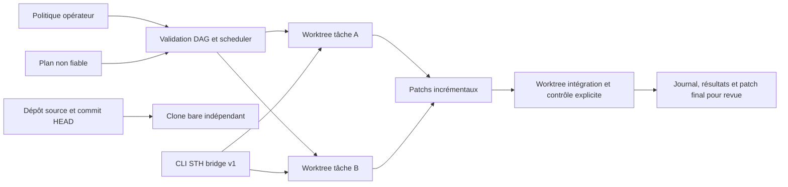

# Architecture et périmètre

La factory reste séparée du CLI STH public. L'analyse préalable a retenu trois responsabilités : orchestration locale, transfert explicite des assets, validation de l'ensemble avant revue. Le scheduler est propre à la factory ; le CLI STH reste une dépendance optionnelle à contrat limité.

## Plan et intégration

Le plan est un objet `tasks`. Chaque tâche possède un `id`, un `runtime` (`fake` ou `command`), éventuellement `depends_on`, `assets`, `prompt`, `command` et `files` pour le faux runtime. Les identifiants sont bornés, sans séparateurs. Les doublons, dépendances inconnues et cycles sont refusés avant exécution. La commande doit être un nom autorisé par la politique. Les tâches prêtes peuvent s'exécuter en parallèle, avec concurrence bornée.

Le dépôt source n'est jamais utilisé comme répertoire de travail d'une tâche. Un clone bare sans objets partagés est créé dans le dossier d'exécution ; ses worktrees partent tous du même commit source HEAD épinglé. Leur création est sérialisée pour éviter les courses sur les métadonnées Git ; les runtimes peuvent ensuite travailler en parallèle. Les changements humains non commités ne sont pas inclus dans ce snapshot. Les tâches ne modifient ni l'index ni les références du dépôt source. Les hooks et fsmonitor Git sont désactivés, la configuration globale et l'environnement utilisateur ne sont pas hérités.

Avant une tâche, les patchs **incrémentaux** de ses ancêtres sont appliqués dans l'ordre topologique, une seule fois par ancêtre. Un conflit échoue sans modification du dépôt source. Une tâche exporte `delta.patch` pour ses descendants et `changes.patch` pour la revue cumulative depuis le commit source. Les tests prouvent les dépendances transitives, l'intégration de deux changements et les conflits.

Une dépendance peut donc contenir le code d'une autre. Une tâche `integration` avec commande de contrôle est nécessaire pour tester leur comportement combiné : un succès individuel ne vaut pas test d'intégration. Le faux runtime ne constitue jamais une preuve de développement par un modèle.

## Contrat du runtime de processus

L'argv exact vient de la politique opérateur et est exécuté sans shell, avec cwd du worktree. Une requête JSON UTF-8 est envoyée sur stdin : `protocol_version: 1`, `task`, `sth` et une description textuelle du niveau de confiance. Le runtime peut écrire des fichiers dans le worktree ; sa sortie stdout/stderr est enregistrée, mais n'est jamais interprétée comme une commande ou une permission. Un code de sortie non nul échoue. Un retour zéro indique uniquement que le processus a terminé : la qualité doit être vérifiée par une tâche de contrôle explicite.

`runtimes/codex.py --binary /absolute/path/codex` est un adaptateur optionnel : requête transformée en prompt, `exec --json`, sandbox `workspace-write`, approbation `never`, sans configuration utilisateur. Il ne fournit aucune authentification. Le HOME éphémère et l'environnement minimal empêchent l'héritage implicite des secrets. L'opérateur doit intégrer un runtime isolé et une authentification de développement contrôlée avant usage réel ; aucun appel de modèle n'a été prouvé ici.

## Contrat STH

Référence inspectée : `Skills-transfer-hub/skills-transfer-hub`, commit `695b154094664df194907674dbb0bca01229dbd7`, notamment `cmd/bridge.go` et `internal/fs/local_library.go`. Binaire réellement testé : version Alpha 0.2.44, archive officielle vérifiée par le SHA256 publié (voir validation).

La factory lance `sth bridge --stdio` dans le worktree et échange des lignes JSON-RPC 2.0 avec identifiants entiers strictement correspondants : `handshake` avec `protocol_version: 1`, `status`, puis `library.get` avec `id` pour les assets explicitement demandés. La version, les méthodes annoncées, les erreurs, les identifiants et le nombre de réponses sont vérifiés. Toute erreur bloque la tâche. La factory n'appelle ni catalogue distant ni méthode cloud ni méthode d'installation/publication.

Le contexte lu et les réponses brutes sont conservés dans `sth.json`. `STH_MCP_LOCAL_ONLY=1` et un `STH_USER_CONFIG_DIR` neuf sont fournis, mais **ce drapeau concerne le MCP** : la localité du bridge repose sur les seules méthodes locales utilisées et l'absence de connexion héritée. Le bridge ne fournit pas de scheduler ni de lancement d'agent.

## Preuves et états

`events.jsonl` contient les démarrages, fins et blocages ; `summary.json` contient le commit source, l'état de chaque tâche et l'empreinte SHA256 des patchs cumulés. Chaque tâche conserve `result.json`, ses patchs et, pour les processus, stdin/stdout/stderr. Le statut est `succeeded`, `failed`, `timed_out`, `cancelled` ou `blocked`. Un échec ou une annulation pendant la préparation conserve le plan, la politique, le journal et un résumé `phase: setup` ; les tâches y sont `not_started`. `source_unchanged` vaut `null` si la vérification finale est interrompue, et non une garantie positive.

L'empreinte source compare HEAD, l'état Git, les différences suivies, les modes et contenus des fichiers suivis et non suivis non ignorés. Elle ne couvre pas les fichiers ignorés, les autres dossiers ni les opérations Git externes concurrentes. Une altération détectée fait échouer le résumé ; elle n'est pas restaurée, afin de ne pas écraser le travail humain. Ce contrôle ne remplace pas une isolation système.

Le journal est local, modifiable par le même utilisateur système, sans signature ni stockage externe. La v2 ajoute un état SQLite et une reprise explicite, un backend conteneur facultatif, des adaptateurs neutres et un cockpit local en lecture seule (documentation dans `docs/`). Il n'y a pas de queue distribuée, de reprise automatique des commandes interrompues, de PR automatique ou de déploiement.
