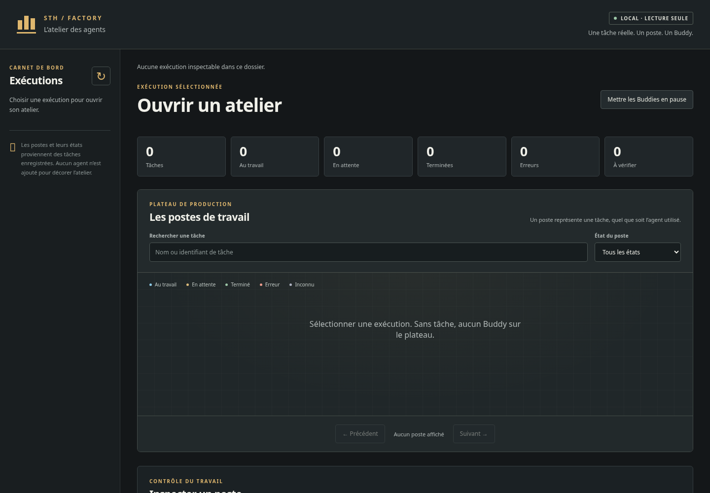
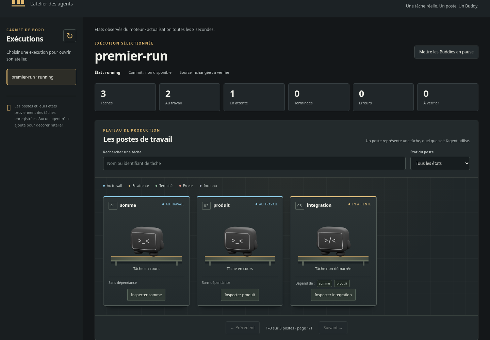
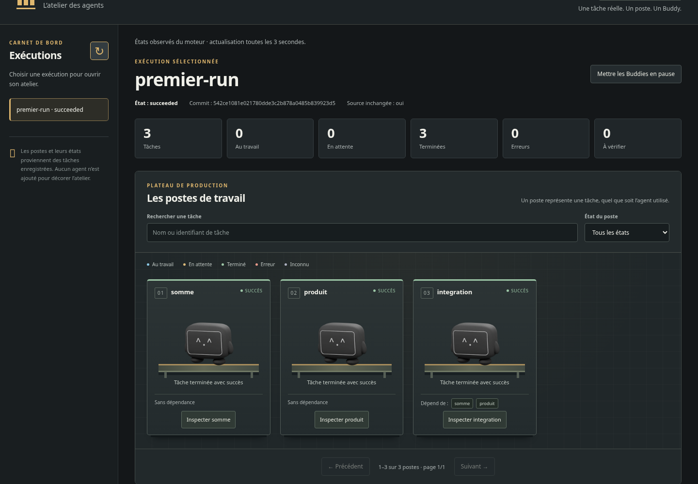
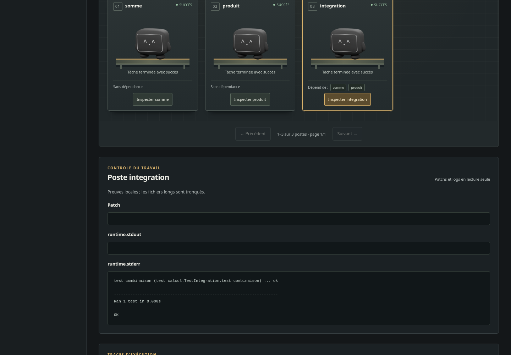
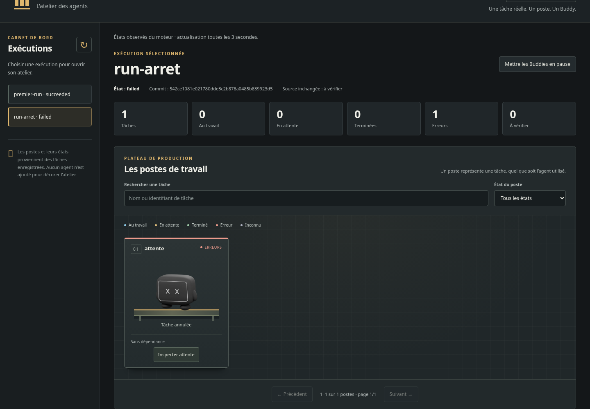
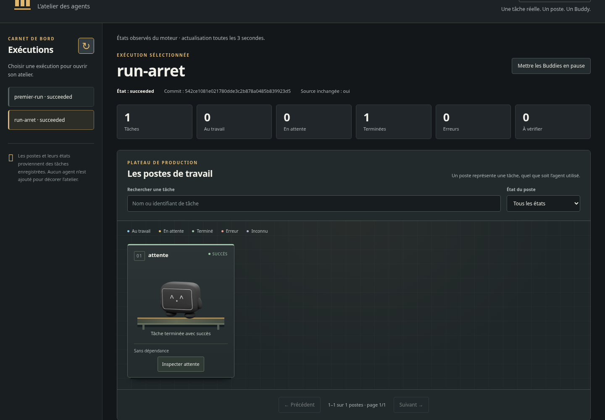
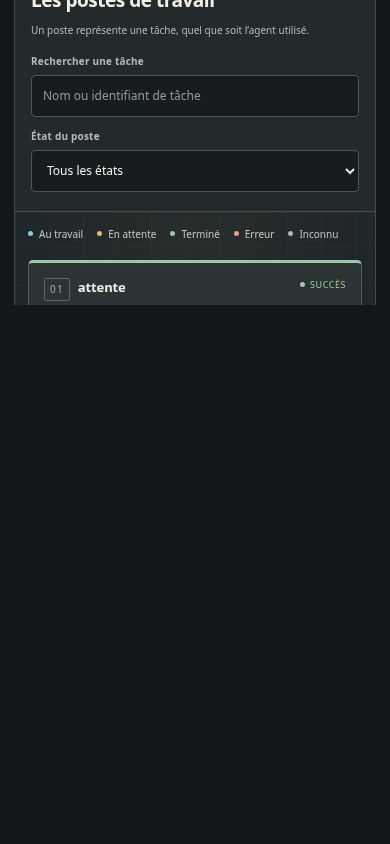

# STH Factory — Guide utilisateur pas à pas

**Pour Hugo et pour un nouveau projet — version atelier, 4 novembre 2026.**

Version du code : `4110b6c6312b621344e0bc213f834ae768689d86`, branche locale `factory/atelier`.

L’objectif de ce parcours est de lancer des tâches sur un dépôt Git, suivre un Buddy par tâche, lire les preuves et reprendre un travail arrêté. Compter environ 15 à 25 minutes pour lire et suivre le parcours. Le temps dépend surtout de la lecture ; les tests d’exemple sont courts.

La factory est un orchestrateur local. Elle organise un plan de tâches déjà défini et leurs dépendances ; elle ne transforme pas automatiquement une idée en logiciel. Elle ne choisit aucun agent ni fournisseur. Le cockpit observe les exécutions, en lecture seule.

Ce guide a été vérifié depuis l’archive du code et un environnement Python neufs, sur un système Linux existant. Ce n’est pas une installation d’OS vierge. Les captures proviennent de ce parcours réel. Aucun modèle IA n’a été appelé.

## 1. Préparer la machine et les fichiers

Il faut Linux/POSIX, Bash, Python 3.12 ou plus récent avec le module venv, Git et un navigateur moderne. Le cœur utilise uniquement la bibliothèque standard Python : pas de pip install, npm install, clé API ou compte STH à prévoir pour ce parcours. Node n’est requis que pour un projet Node ou certains tests de développement ; Docker reste facultatif.

Windows natif n’est pas pris en charge par ce guide. WSL et macOS n’ont pas été validés ici. Si Python, Git ou venv manque, installer ces prérequis par la procédure habituelle de votre système avant de continuer ; aucune commande d’installation système non exécutée n’est proposée.

Récupérer les deux livrables privés : ce guide et `sth-factory-atelier-source.zip`. L’archive complète du guide contient aussi cette archive du code, les captures et les scripts. Il n’y a pas de dépôt publié à cloner ni de commande globale `sth-factory` à installer.

Ouvrir un terminal Bash. Les variables ci-dessous restent dans ce même terminal, appelé **terminal A**. Remplacer le chemin de SOURCE_ZIP par le chemin réel du fichier reçu, entre guillemets. Ne pas laisser `/chemin/vers` littéralement.

```bash
SOURCE_ZIP="/chemin/vers/sth-factory-atelier-source.zip"
```

Pour copier les commandes longues, préférer le Markdown ou les scripts fournis : la mise en page du PDF peut couper visuellement une ligne.

Les commandes suivantes affichent les versions, vérifient Python/POSIX, extraient le code dans un dossier neuf et créent un venv sans pip. Si une commande échoue, examiner son message avant de poursuivre. Garder le dossier temporaire pendant les essais ; il peut être supprimé automatiquement au redémarrage selon votre système. Pour un usage durable, choisir dès le départ un emplacement persistant personnel, hors du dépôt projet.

```bash
# Fournir SOURCE_ZIP avec le chemin de l’archive reçue.
python3 --version
git --version
python3 -c 'import sys,os; assert sys.version_info >= (3,12); assert os.name == "posix"'
FACTORY_GUIDE_ROOT="$(mktemp -d /tmp/sth-factory-guide.XXXXXX)"
python3 -m zipfile -e "$SOURCE_ZIP" "$FACTORY_GUIDE_ROOT"
FACTORY="$FACTORY_GUIDE_ROOT/sth-factory"
python3 -m venv --without-pip "$FACTORY_GUIDE_ROOT/venv"
PY="$FACTORY_GUIDE_ROOT/venv/bin/python"
"$PY" "$FACTORY/factory.py" --help
```

Résultat attendu : Python 3.12+, une version Git, puis l’aide contenant `init`, `doctor`, `plan`, `run`, `resume`, `status`, `review` et `serve`. Le code ne modifie aucun dépôt existant à cette étape.

Pour suivre sans recopier les blocs longs, les fichiers `scripts/01-installer.sh` à `10-patch.sh` contiennent les mêmes commandes. Les charger avec `source` dans le même terminal préserve les variables. Ne pas exécuter tous les scripts d’un coup : le cockpit et l’arrêt contrôlé ont des étapes d’observation intermédiaires.

## 2. Créer un nouveau projet d’essai

Cet exemple fabrique son propre petit projet Python : addition, multiplication et trois tests unittest. Ce n’est pas un dépôt tiers. Les pauses de quatre secondes dans deux tests servent à voir les tâches parallèles dans le cockpit. Ces tests sont des processus réels, déterministes, sans agent IA.

Les commandes Git utilisent une identité uniquement pour le commit d’exemple ; elles ne changent pas votre configuration Git globale. La note humaine est volontairement créée après le commit : elle doit rester intacte.

```bash
PROJET="$FACTORY_GUIDE_ROOT/mon-projet"
mkdir "$PROJET"
cat > "$PROJET/calcul.py" <<'PYTHON'
def somme(a, b):
    return a + b

def produit(a, b):
    return a * b
PYTHON
cat > "$PROJET/test_calcul.py" <<'PYTHON'
import time
import unittest
from calcul import somme, produit

class TestSomme(unittest.TestCase):
    def test_somme(self):
        time.sleep(4)  # Laisse le temps d’observer ce test dans le cockpit.
        self.assertEqual(somme(2, 3), 5)

class TestProduit(unittest.TestCase):
    def test_produit(self):
        time.sleep(4)
        self.assertEqual(produit(5, 4), 20)

class TestIntegration(unittest.TestCase):
    def test_combinaison(self):
        self.assertEqual(produit(somme(2, 3), 4), 20)
PYTHON
git -C "$PROJET" init -q
git -C "$PROJET" add calcul.py test_calcul.py
git -C "$PROJET" -c user.name='Démo locale' \
  -c user.email='demo@example.invalid' commit -qm 'Premier exemple'
printf 'Note humaine à préserver\n' > "$PROJET/note-humaine.txt"
```

Résultat attendu : un dépôt avec un premier commit et une note humaine non suivie. Les tâches partiront du commit `HEAD` ; elles ne recevront pas la note ni les changements non commités.

Pour un projet existant : utiliser la racine de votre vrai dépôt Git comme PROJET, avec au moins un commit. Ne pas rejouer la création des fichiers d’exemple dans votre projet. Commiter les changements que les tâches doivent voir avant le lancement ; les modifications locales non commitées sont préservées mais exclues de l’entrée. Les dépendances et fichiers ignorés par Git ne sont pas automatiquement copiés.

## 3. Configurer le plan et les commandes autorisées

`init` crée un dossier de configuration neuf. Il ne modifie pas le projet et n’installe pas ses dépendances. Le modèle Python initial exécute unittest ; le modèle Node exécute node --test. Ils échouent si aucun test n’est découvert. Ni pytest, ni npm test, ni build ne sont déduits automatiquement.

Le plan indique les tâches et leurs dépendances. La politique indique les argv complets autorisés, les workers simultanés et les limites. Un champ de tâche ou une sortie d’agent ne peut pas autoriser une nouvelle commande.

Dans cet exemple, somme et produit démarrent en parallèle ; integration attend les deux succès. Nous autorisons deux tentatives dès le départ. Les commandes utilisent explicitement le Python du venv. C’est important : le template actuel résout l’interpréteur et peut perdre le chemin du venv ; pour un projet avec dépendances, relire et corriger les argv, comme ci-dessous, puis installer les dépendances dans l’environnement choisi avant le run.

```bash
CONFIG="$FACTORY_GUIDE_ROOT/config"
RUNS="$FACTORY_GUIDE_ROOT/runs"
mkdir "$RUNS"
"$PY" "$FACTORY/factory.py" init --destination "$CONFIG" --template python
# Adapter le plan et les argv autorisés, sans dépendre d’un agent.
"$PY" - "$CONFIG" "$PY" <<'PYTHON'
import json, sys
from pathlib import Path
config = Path(sys.argv[1])
python = sys.argv[2]  # Conserve le chemin du venv sans résoudre son symlink.
policy = json.loads((config / 'operator-policy.json').read_text())
policy.update(workers=2, max_attempts=2, task_timeout=60, run_timeout=1800)
policy['commands'] = {
    'somme': [python, '-m', 'unittest', '-v', 'test_calcul.TestSomme'],
    'produit': [python, '-m', 'unittest', '-v', 'test_calcul.TestProduit'],
    'integration': [python, '-m', 'unittest', '-v', 'test_calcul.TestIntegration'],
}
plan = {'tasks': [
    {'id': 'somme', 'runtime': 'command', 'command': 'somme'},
    {'id': 'produit', 'runtime': 'command', 'command': 'produit'},
    {'id': 'integration', 'runtime': 'command', 'command': 'integration',
     'depends_on': ['somme', 'produit']},
]}
(config / 'operator-policy.json').write_text(json.dumps(policy, indent=2))
(config / 'plan.json').write_text(json.dumps(plan, indent=2))
PYTHON
"$PY" "$FACTORY/factory.py" doctor --repo "$PROJET" \
  --policy "$CONFIG/operator-policy.json"
"$PY" "$FACTORY/factory.py" plan --plan "$CONFIG/plan.json" \
  --policy "$CONFIG/operator-policy.json"
```

Résultat attendu : `doctor` indique `ready: true`, puis `plan` renvoie l’ordre somme, produit, integration et `workers: 2`. `plan` valide le graphe, il ne lance aucun agent et n’invente pas de plan.

`doctor` inspecte les prérequis locaux. Son résultat ne prouve ni que les tests passent, ni qu’un agent est authentifié, ni qu’une sandbox est sûre. Les exécutables de la politique ont des chemins absolus propres à cette machine ; les régénérer ou les relire sur une autre machine.

## 4. Ouvrir l’atelier avant le lancement

Depuis le terminal A, afficher la commande complète à copier dans un **terminal B** :

```bash
printf '"%s" "%s/factory.py" serve --runs-root "%s" --port 0\n' "$PY" "$FACTORY" "$RUNS"
```

Dans B, exécuter la ligne affichée. Elle appelle `factory.py serve --runs-root ... --port 0`. Le port 0 choisit un port local disponible. Le serveur imprime un objet JSON contenant `url`, `read_only: true` et `loopback_only: true`.

Copier uniquement la valeur de `url`, sans guillemets JSON, dans le navigateur de la même machine. Garder la partie après `#` : c’est la capacité d’accès temporaire. La page retire cette partie de la barre d’adresse après ouverture. Pour rouvrir ou recharger la page, reprendre le lien complet du terminal B. Ne pas partager ce lien ni exposer ce port sur Internet.

Au départ, l’atelier est vide : aucun poste, aucun Buddy. Le serveur ne doit pas être placé dans le dossier source du projet.



## 5. Lancer le premier travail

Revenir au terminal A. Laisser B et le navigateur ouverts.

```bash
"$PY" "$FACTORY/factory.py" run --repo "$PROJET" \
  --output "$RUNS/premier-run" --plan "$CONFIG/plan.json" \
  --policy "$CONFIG/operator-policy.json"
```

Dans le navigateur, cliquer sur Actualiser les exécutions puis sur premier-run. Deux postes travaillent pendant les tests somme et produit ; integration attend, puis se termine après eux. Les tâches étant courtes, on peut arriver directement au résultat final : ce n’est pas un échec du cockpit. Pour recommencer, choisir un autre dossier de sortie neuf, par exemple premier-run-2.

Résultat attendu dans le terminal : `status: succeeded`, trois tâches succeeded et `source_unchanged: true`. Une commande run renvoie 0 en cas de succès, 1 sinon. Le dossier de sortie doit être neuf et hors du dépôt source. Ne pas relancer run avec un ancien dossier : choisir resume si ses conditions sont réunies, ou un nouveau dossier.



## 6. Lire l’atelier et utiliser Buddy

- Un poste et un Buddy représentent une tâche réellement planifiée ou observée. Sans tâche, aucun Buddy de remplissage.
- Au travail : séquence officielle animée, seulement si le moteur rapporte la tâche running et que son superviseur est vérifié actif.
- En attente : tâche pas encore lancée, par exemple en attente d’une dépendance.
- Succès : pose officielle de succès de cette tâche, même si une autre tâche fait échouer le run.
- Erreur : échec, délai dépassé, annulation, interruption ou dépendance bloquée. La légende précise le statut.
- À vérifier : état inconnu ou activité non confirmée. Aucune activité n’est inventée.

Le bouton global met les animations en pause sans arrêter les tâches ni les mises à jour. La réduction des mouvements du système est respectée ; les cartes hors écran et les onglets masqués n’animent pas leurs Buddies. Attente, succès et erreur utilisent une pose fixe.

Les compteurs portent sur tout le lot. La recherche et le filtre d’état réduisent les postes affichés ; au plus 24 cartes sont rendues par page. Utiliser Suivant et Précédent pour les gros lots. L’actualisation automatique intervient environ toutes les trois secondes. La sélection d’un poste donne ses preuves, pas celles d’un autre. Le cockpit ne possède aucun bouton de lancement, d’arrêt, de merge ou de déploiement.

Buddy est le personnage officiel, présenté avec ses rendus 3D pré-calculés inchangés. Ce n’est pas une nouvelle scène WebGL. Le code est MIT ; les modèles, images, animations et marques Buddy/STH restent à droits réservés. L’autorisation accordée pour cette factory ne donne pas une licence générale de mascotte à d’autres projets. Ceux-ci peuvent utiliser la CLI sans Buddy et doivent examiner les droits avant réutilisation graphique.



## 7. Consulter les preuves et protéger le travail humain

Dans l’atelier, cliquer sur Inspecter integration. La section Contrôle du travail affiche les sorties et patchs disponibles. Le journal récent présente des événements réellement enregistrés. Les fichiers longs sont tronqués ; un patch tronqué n’est pas applicable.

Les mêmes informations sont disponibles en CLI :

```bash
"$PY" "$FACTORY/factory.py" status --run-dir "$RUNS/premier-run"
"$PY" "$FACTORY/factory.py" review --run-dir "$RUNS/premier-run" --task integration
git -C "$PROJET" status --short
cat "$PROJET/note-humaine.txt"
```

Résultat attendu : logs unittest avec OK ; `git status --short` montre toujours `?? note-humaine.txt` et son contenu est intact. Ces tâches exécutent des tests : un patch vide est normal et ne signifie pas qu’un code a été généré.

Les traces de chaque run sont dans son dossier :

- `plan.json`, `policy.json` : copie du plan et de la politique utilisés ; la politique originale reste sous contrôle de l’opérateur.
- `events.jsonl`, `summary.json` : événements et résumé.
- `state.sqlite3`, `run.lock` : état durable et verrou de supervision. Ne pas les modifier pour forcer une reprise.
- `tasks/<id>/` : result.json, logs runtime.stdout/runtime.stderr, entrées de processus et patchs lorsqu’ils ont été produits.
- `worktrees/<id>/` : copie Git de travail propre à la tâche.
- `attempts/<id>/<numéro>/` : ancienne tentative archivée après réessai explicite.

Les logs sont des données non fiables et peuvent contenir des informations sensibles selon les commandes exécutées. Les relire avant partage. Les preuves locales ne sont pas inviolables : le même utilisateur système peut les modifier.



## 8. Arrêter une tâche sans perdre les preuves

Il n’y a pas de sous-commande cancel. Lors du lancement, on peut choisir un marqueur avec `--cancel-file`, puis créer ce fichier pour demander l’arrêt. SIGINT ou SIGTERM adressé au superviseur est une autre voie d’arrêt contrôlé. Dans un terminal au premier plan, Ctrl+C envoie SIGINT. Éviter les arrêts brutaux ; des enfants ou conteneurs peuvent survivre à la mort du superviseur.

Pour vérifier le mécanisme sans interrompre votre premier exemple, préparer un second run distinct. Son worker de confiance attend un marqueur extérieur au dépôt, puis écrit reprise.txt. Ce mécanisme est un outil pédagogique ; ce n’est pas une fonctionnalité de pause universelle des agents.

```bash
CONFIG_ARRET="$FACTORY_GUIDE_ROOT/config-arret"
"$PY" "$FACTORY/factory.py" init --destination "$CONFIG_ARRET" --template python
# Worker de démonstration de confiance : attente, puis écriture d’un fichier.
cat > "$CONFIG_ARRET/attente.py" <<'PYTHON'
import json, sys, time
from pathlib import Path
request = json.load(sys.stdin)
print('Worker en attente : ' + request['task']['id'], flush=True)
while not Path(sys.argv[1]).exists():
    time.sleep(0.05)
Path('reprise.txt').write_text('Tâche reprise et terminée\n')
PYTHON
"$PY" - "$CONFIG_ARRET" "$PY" "$FACTORY_GUIDE_ROOT" <<'PYTHON'
import json, sys
from pathlib import Path
config, python, root = Path(sys.argv[1]), sys.argv[2], Path(sys.argv[3])
policy = {'commands': {'attente': [python, str(config/'attente.py'),
                                  str(root/'AUTORISER_FIN')]},
          'workers': 1, 'max_tasks': 2, 'max_attempts': 2,
          'task_timeout': 1800, 'run_timeout': 3600}
plan = {'tasks': [{'id': 'attente', 'runtime': 'command', 'command': 'attente'}]}
(config/'operator-policy.json').write_text(json.dumps(policy, indent=2))
(config/'plan.json').write_text(json.dumps(plan, indent=2))
PYTHON
```

Lancer ce run en arrière-plan dans le même terminal A, afin de conserver son PID pour wait :

```bash
"$PY" "$FACTORY/factory.py" run --repo "$PROJET" \
  --output "$RUNS/run-arret" --plan "$CONFIG_ARRET/plan.json" \
  --policy "$CONFIG_ARRET/operator-policy.json" \
  --cancel-file "$FACTORY_GUIDE_ROOT/STOP" \
  > "$FACTORY_GUIDE_ROOT/resultat-arret.json" &
RUN_PID=$!
printf 'PID du superviseur : %s\n' "$RUN_PID"
```

Dans le cockpit, actualiser puis sélectionner run-arret. Attendre que le poste attente soit au travail. Ensuite, dans le même terminal A :

```bash
# Attendre de voir le poste « attente » au travail avant cette commande.
touch "$FACTORY_GUIDE_ROOT/STOP"
# wait retourne 1 ici : c’est l’arrêt volontaire attendu.
if wait "$RUN_PID"; then
  printf 'Le run était déjà terminé.\n'
else
  printf 'Arrêt demandé : examiner le résultat et les logs.\n'
fi
"$PY" "$FACTORY/factory.py" status --run-dir "$RUNS/run-arret"
"$PY" "$FACTORY/factory.py" review --run-dir "$RUNS/run-arret" --task attente
```

Résultat attendu : la tâche attente est cancelled ; le résumé global de ce scénario est failed. Le code non nul du run est attendu pour cet arrêt volontaire. Les logs et la première tentative restent présents. Arrêter le serveur du cockpit avec Ctrl+C dans B ne demande pas l’arrêt d’un run lancé dans A.



## 9. Reprendre explicitement un travail arrêté

Avant de reprendre : vérifier les logs, la fin du superviseur et l’absence de processus survivant ambigu ; conserver le dépôt, la politique et les preuves. Le guide utilise max_attempts: 2 dès le premier lancement. On ne peut pas augmenter ce budget en changeant la politique après coup.

La reprise demande le même dépôt à son chemin d’origine, la même politique JSON et le même exécutable STH si STH était utilisé. Aucun changement du dépôt source n’est permis entre le lancement et la reprise. Le délai global continue à courir pendant l’arrêt. Un délai expiré, un dépôt modifié ou une préparation inachevée imposent un nouveau run.

Retirer le marqueur STOP et autoriser notre worker d’exemple à finir, puis demander précisément le réessai de la tâche annulée :

```bash
# Retirer uniquement le marqueur d’arrêt de cet exemple.
"$PY" - "$FACTORY_GUIDE_ROOT/STOP" <<'PYTHON'
import sys
from pathlib import Path
Path(sys.argv[1]).unlink(missing_ok=True)
PYTHON
# Ce second marqueur autorise le worker de démonstration à finir.
touch "$FACTORY_GUIDE_ROOT/AUTORISER_FIN"
"$PY" "$FACTORY/factory.py" resume --repo "$PROJET" \
  --output "$RUNS/run-arret" --policy "$CONFIG_ARRET/operator-policy.json" \
  --cancel-file "$FACTORY_GUIDE_ROOT/STOP" --retry-task attente
"$PY" "$FACTORY/factory.py" status --run-dir "$RUNS/run-arret"
```

Résultat attendu : le run et la tâche attente sont succeeded. L’ancienne tentative est conservée sous attempts/attente/1 ; reprise.txt apparaît dans le worktree de la tâche, pas dans le dépôt source.

resume sans --retry-task réutilise les résultats terminés et ne relance pas automatiquement une tâche échouée. Les succès déjà vérifiés ne sont pas rejoués. Une tâche blocked ne se réessaie pas directement : examiner et corriger la cause, puis utiliser un nouveau run si le graphe terminal bloqué l’exige. La factory ne garantit pas l’exécution exactement une fois d’un effet externe : un réessai peut répéter une requête distante antérieure.

Copier un dossier de preuves sur une autre machine permet sa lecture ; ce n’est pas un paquet de reprise portable. Pour un autre projet ou emplacement, régénérer sa configuration et lancer un nouveau run.



## 10. Examiner et utiliser un patch sans toucher à la source

Les tests seuls du premier exemple ne génèrent pas de code. Pour voir un changement réel, la démonstration fournie crée un dépôt jetable, fait écrire add.py et multiply.py par deux runtimes fake déterministes, puis lance un vrai processus Python d’intégration. Aucun modèle IA n’intervient. Elle vérifie aussi la préservation de changements humains.

Les commandes suivantes appliquent uniquement le patch cumulatif terminal dans une nouvelle copie de revue. Elles n’effectuent aucun commit de résultat, push, merge ou déploiement.

```bash
# Démonstration séparée avec deux générateurs fake et un vrai test Python.
"$PY" "$FACTORY/demo.py" --output "$FACTORY_GUIDE_ROOT/demo-patch"
"$PY" "$FACTORY/factory.py" review \
  --run-dir "$FACTORY_GUIDE_ROOT/demo-patch/run" --task integration
REVUE="$FACTORY_GUIDE_ROOT/revue-patch"
git clone -q --no-local "$FACTORY_GUIDE_ROOT/demo-patch/source" "$REVUE"
PATCH="$FACTORY_GUIDE_ROOT/demo-patch/run/tasks/integration/changes.patch"
git -C "$REVUE" apply --check "$PATCH"
git -C "$REVUE" apply "$PATCH"
# Le patch reste non commité dans cette copie de revue, sans push ni merge.
git -C "$REVUE" status --short
"$PY" - "$REVUE" <<'PYTHON'
import sys
sys.path.insert(0, sys.argv[1])
from add import add
from multiply import multiply
assert multiply(add(2, 3), 4) == 20
print('Patch relu appliqué dans la copie jetable : vérification réussie.')
PYTHON
```

Résultat attendu : add.py et multiply.py apparaissent dans la copie de revue et le contrôle affiche une réussite. Le dépôt de démonstration d’origine n’est pas modifié.

changes.patch contient le changement cumulatif depuis le commit de base, y compris les ancêtres nécessaires. delta.patch contient seulement l’incrément de la tâche. Ne pas appliquer tous les changes.patch successifs : un seul patch cumulatif terminal relu suffit pour cette chaîne. Un git apply --check réussi ne prouve pas que le code est correct ; relire le patch complet puis exécuter les tests adaptés.

## 11. Brancher un autre projet ou un autre runtime

Pour un projet Python existant : garder la factory hors du dépôt, définir PROJET sur sa racine, créer un nouveau CONFIG avec init, relire ses commandes, lancer doctor puis plan et run avec un nouveau dossier de sortie. Une suite pytest ou une compilation doit être autorisée explicitement par ses argv ; elle n’est pas installée ni sélectionnée automatiquement.

Pour Node, choisir --template node à la place de python. Cette commande a été vérifiée sur un second projet Node indépendant, avec un vrai test node --test, sans STH. Les dépendances ignorées comme node_modules ne sont pas copiées depuis le dépôt source. Préparer l’environnement d’exécution et sa commande avant le run.

Le moteur accepte deux types de runtime : fake, pour écrire des fichiers de test prédéfinis, et command, pour lancer un argv autorisé. Un vrai processus n’est pas nécessairement un agent IA. Dans le premier exemple, command lance des tests Python ; dans la démonstration de patch, fake écrit un contenu déjà défini.

Un runtime de commande reçoit une requête JSON v1 sur stdin : protocol_version, task, sth facultatif et trust. Il travaille dans son répertoire de tâche ; une sortie 0 termine le processus avec succès, une autre valeur fait échouer la tâche et bloque ses dépendants. stdout et stderr deviennent des preuves, jamais des permissions.

Le même plan peut conserver ses noms de commandes lorsqu’on remplace l’implémentation dans la politique. runtimes/command.py fournit un adaptateur générique sans shell. Cette enveloppe a réellement exécuté le même plan Python pendant la validation du guide. Les adaptateurs facultatifs runtimes/codex.py et runtimes/claude.py sont présents ; leur existence et les tests avec stubs ne certifient pas deux agents réels authentifiés.

Pour un vrai agent, l’opérateur doit choisir le binaire, adapter les argv, préparer l’isolation et intégrer explicitement l’authentification de développement. Le runtime reçoit un HOME neuf et un environnement minimal : le login de l’hôte, les clés exportées et le venv activé du shell ne sont pas transmis automatiquement. Il n’existe pas encore de parcours clé en main de provisionnement des secrets ou d’accès réseau modèle. Aucune commande de login ou création de credential n’est inventée dans ce guide.

STH reste facultatif. Son CLI éventuel fournit des assets via le bridge ; il ne remplace ni le scheduler ni les agents. Le parcours ci-dessus ne le requiert pas.

## 12. Sécurité, limites et fonctions encore absentes

- Mode local : destiné à des dépôts et commandes de confiance relus. Les worktrees isolent les fichiers de travail entre tâches, mais ne sont pas une sandbox de sécurité et ne protègent pas tout le système hôte.
- Backend conteneur facultatif : image immuable déjà disponible, nonroot, limites de ressources et network=none. Il n’installe ni ne télécharge l’image automatiquement. Les chemins des commandes doivent exister dans l’image. Le réseau désactivé empêche les appels à un modèle distant. Le backend a été testé auparavant ; ce parcours d’installation du guide utilise le mode local.
- Docker partage le noyau et peut utiliser un daemon rootful. Pas de quota disque dur pour les snapshots ; les limites de logs ne sont pas un quota de stockage.
- Aucun agent IA réel authentifié n’a été exécuté dans la preuve du guide. Pas de sélection automatique de fournisseur, de compte, de clé ni de budget financier effectivement imposé.
- Le cockpit est local et en lecture seule : pas de lancement, annulation ou modification du plan depuis le navigateur. Pas de multi-utilisateur, d’authentification collaborative ou d’exposition distante validée ici.
- Pas d’auto-merge, push ou déploiement. Une préparation de PR et une création explicite de brouillon existent séparément dans le code ; aucune PR réelle n’a été créée ou testée via un compte connecté pour ce guide.
- Un arrêt du superviseur ne prouve pas l’arrêt de tous ses descendants. Un effet externe n’est pas garanti exactement une fois.
- La CLI reste utilisable sans les visuels Buddy ; leurs droits sont distincts de MIT.

## 13. Résoudre les problèmes courants

- configuration destination already exists : choisir un nouveau dossier CONFIG. init ne remplace pas vos fichiers, même si le dossier est vide.
- File exists lors de run : choisir un nouveau OUTPUT ; ne pas effacer un ancien run pour le relancer au même emplacement sans examen.
- ready: false : lire chaque vérification de doctor, notamment la racine Git, le premier commit et les chemins absolus des exécutables. ready: true ne dispense pas des tests.
- No tests discovered : le modèle cherche unittest ou node --test ; vérifier le format et la découverte réelle des tests, ou définir une commande adaptée.
- ModuleNotFoundError : dépendances absentes du runtime. Vérifier l’argv Python, son venv et ce qui existe réellement dans le worktree ou l’image. Le venv hôte ignoré par Git n’est pas copié.
- Lien du cockpit refusé : reprendre l’URL complète imprimée par le serveur, avec sa capacité. Le navigateur doit accéder à la même machine ; ne pas créer de tunnel public pour contourner cette limite.
- Buddy figé : vérifier état au travail, bouton pause, réduction des mouvements, visibilité de la carte et état du superviseur. Un poste en attente, succès ou erreur est volontairement en pose fixe.
- Reprise refusée : vérifier politique identique, chemins d’origine, absence de changements source, budget de tentatives/délai et anciens processus. Ne pas éditer state.sqlite3 ou les reçus pour passer outre.



## 14. Ce qui a été vérifié pour ce guide

L’archive de code testée a pour SHA-256 : 37f65cd696cb4a14cc1c69f3eea81155c52cefdcaa75fd01647fce8135f05eeb.

Vérifications exécutées : extraction neuve et venv neuf sans paquet tiers du cœur ; init, doctor, plan ; trois tâches Python dont deux en parallèle ; lecture status et review ; note humaine préservée ; annulation par marqueur puis réessai explicite et archivage ; démonstration de patch appliqué et testé dans une copie jetable ; deuxième projet Node ; même plan à travers l’adaptateur générique ; démarrage et arrêt SIGINT du serveur ; vrais screenshots Chromium sans erreur navigateur. La suite complète de la version atelier avait également 107 tests réussis sans skip ; elle n’est pas présentée comme une nouvelle exécution de ces 107 tests dans le venv du guide.

Les vérifications ne constituent pas une certification d’un modèle IA, d’un fournisseur authentifié ou d’une installation sur un OS vierge. Les captures ne montrent aucun événement fabriqué. Aucun dépôt publié, aucune PR, aucun merge ni déploiement.

L’archive de ce guide contient GUIDE-UTILISATEUR.md, le PDF, les scripts numérotés, les captures, les résultats lisibles de validation et l’archive source testée avec ses licences et notices. Les fichiers paths.json et session de validation spécifiques à la machine ne sont pas nécessaires à l’utilisateur ; le journal fourni aide à auditer les résultats. Les fichiers privés ChatGPT ne prouvent pas une transmission SMS/RCS.

